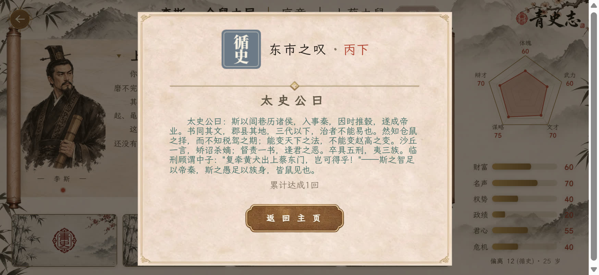
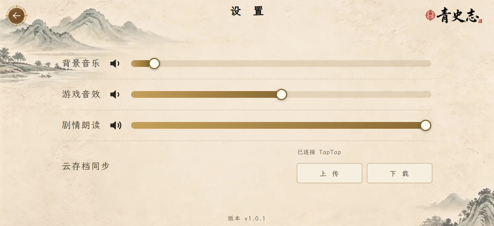

# 《青史志》入局指南

> 一句话:你在一局里扮演历史中的一个具体的人。每一张牌都在"顺势"与"改流"之间挪动一寸,
> 而**偏离度**就是你改写历史的幅度 —— 它既是你的风险,也是你的分数。

> 本文只讲**机制**:属性、卡、险招、危机、章末结算、评级、难度、存档。
> 不含剧情路线、结局达成条件与旗标(那是另一类文章,想看可以另说)。
> 文中的表格由 `prot/guide-export.js` 从剧本数据自动回填(`<!-- AUTO:xxx -->` 标记块),
> 数字与游戏实际一致,游戏数值一改,重跑生成器就跟上。


---

## 一、一局是怎么进行的

一局 = **若干章**,每章 = **若干回合**,每回合 = 打牌 / 处理事件,章末结算,最后落到一个结局。

```
章首(序章)→ 回合循环 → 章末结算 → 下一章 → … → 结局
```

- **回合**:每回合给你 3 张行动卡(另有一条提示条挂着"关键事件卡"),选一张打出去,牌面会结算属性变化与偏离度。
- **关键事件卡**:它不占牌位,表现为顶部提示条,并带**倒计时(3 回合)**。倒计时归零,系统强制把你推进这个事件 —— 该面对的抉择躲不掉。
- **事件**:进入事件页就是几个选项,每个选项各有门槛与后果。**这是全局最关键的选择**,行动卡只是铺垫。
- **章末**:结算页给你看这一章的偏离归因、属性差值、以及可能触发的"历史修正"。
- **结局**:最后一章走完,按你的路线落到一个结局,带印章、评分与十档评级。


---

## 二、十一种属性:你真正在管四件事

| 归类 | 属性 | 管什么 |
|---|---|---|
| **生存** | 体魄、武力 | 命还在不在;武力是某些事的通行证 |
| **资源** | 财富、文才、谋略、辩才 | 财富能"兑换"很多东西;文才/谋略/辩才是智力型门槛的来源 |
| **影响力** | 名声、权势、政绩、君心 | 名声是外部评价,权势是位置,政绩是功业轨道,君心是上位者对你的态度 |
| **风险** | 危机 | 满 100 就出事了(见第七节) |

每项属性 0–100,随数值变化会换一套评语。下表是**李斯**的初值与四档评语:

<!-- AUTO:attrs -->
| 属性 | 初值 | 四档评语(高→低) |
|---|---|---|
| 体魄 | 30 | ≥80 龙精虎猛 / ≥55 筋骨强健 / ≥25 尚可劳碌 / 0 形销体弱 |
| 武力 | 20 | ≥80 万夫不当 / ≥55 骁勇善战 / ≥25 习得武艺 / 0 手无缚鸡 |
| 文才 | 40 | ≥75 学究天人 / ≥55 文采斐然 / ≥35 腹有诗书 / 0 才疏学浅 |
| 谋略 | 50 | ≥80 算无遗策 / ≥55 深谋远虑 / ≥25 粗通权变 / 0 不谙机心 |
| 辩才 | 45 | ≥80 舌动九州 / ≥55 口若悬河 / ≥25 能言善对 / 0 拙于言辞 |
| 财富 | 20 | ≥70 富埒王侯 / ≥40 仓廪充实 / ≥15 尚可维持 / 0 囊中羞涩 |
| 名声 | 10 | ≥80 天下归心 / ≥50 名动诸侯 / ≥25 小有清名 / 0 默默无闻 |
| 权势 | 5 | ≥80 权倾朝野 / ≥50 位高权重 / ≥25 位居朝堂 / 0 人微言轻 |
| 政绩 | 0 | ≥80 功盖当世 / ≥55 政绩斐然 / ≥25 小有建树 / 0 寸功未立 |
| 君心 | 20 | ≥70 圣眷正隆 / ≥45 简在帝心 / ≥20 不咸不淡 / 0 君臣相疑 |
| 危机 | 10 | ≥90 命悬一线 / ≥70 流言中心 / ≥40 暗流涌动 / 0 岁月静好 |
<!-- /AUTO:attrs -->

> 别的剧本初值不同(比如项羽的武力起点更高)。注意**危机**也是一条属性:它越高,评语越凶,越高越接近死线。

---

## 三、偏离度:这局游戏真正的分数

**偏离度**是你"改写历史"的累计幅度,事件与卡都可能推高它。四档:

<!-- AUTO:bands -->
| 档位 | 偏离度上限 | 含义 |
|---|---|---|
| 循史 | ≤ 20 | 完整复刻了历史,连他的错误都没改 |
| 微澜 | ≤ 45 | 大势之内的小挣扎,只在字里行间留了几处批注 |
| 改流 | ≤ 70 | 走向开始变,史官的笔追不上了 |
| 逆天 | ≤ 100 | 无人见过的新历史 —— 无论结局如何,它属于你 |
<!-- /AUTO:bands -->

三点要记住:

1. **偏离度不是惩罚,是刻度**。终局评分里"影响"一项 = 偏离度×0.6 + 功业×0.4 —— 想刷高分,偏离度是主杠杆。
2. **它决定你的终局尾声**:≤20 是"你决定照抄一遍,这也是一种玩法",≤45 是"史书没变,但多了几处批注",再往上就是"史官的笔追不上你"。
3. **它也是结局准入条件**:部分结局带"偏离度上限"门槛,走得太偏或太保守都进不去。

---

## 四、五类行动卡:牌面只是"怎么花"

行动卡分五类。它们的差别不在数值高低,而在**花钱的方向**:

| 卡类 | 作用 | 常见代价 |
|---|---|---|
| **进取** | 换影响力或资源,收益大 | 常带偏离度;容易把危机推高 |
| **兑换** | 用财富/资源换别的东西 | 花钱为主,风险小 |
| **守成** | 补短板、稳住属性 | 收益小,几乎不偏离 |
| **保身** | 压危机、养体魄 | 收益最低,是保险牌 |
| **抉择** | 打出去会进入一次独立抉择(另发选项) | 每两轮强制占一个牌位,整局一张只发一次 |

另外还有一张不在池子里的牌:**求医问药**(染病时额外发,占一个牌位,财富 ≤ 0 时不得求医)。

三条通用规则:

- **硬门槛不达,牌根本不出现**:财富类门槛默认是硬门槛(钱不够就是锁死,不是险招)。
- **软门槛不足,牌上带 ⚠ 徽章**:可以冒险(见第五节)。
- **同一张牌可以反复打,收益不打折**(引擎有"重复使用收益递减"这条规则,但五本剧本都把它关了)。所以一张好牌打满一章是可行的 —— 只是每打一次,你都要重新掂量这次的风险。
- **抉择卡落定后整局不再发**。

---

## 五、险招:什么时候该赌

⚠ 徽章的意思是"你条件不够,想走这条路就得赌"。

<!-- AUTO:risk -->
| 差距(还差几点) | 成算 | 备注 |
|---|---|---|
| ≤ 3 | 七成 | 几乎稳过 |
| 4–6 | 五成 |  |
| 7–9 | 四成 |  |
| 10–12 | 三成 |  |
| 13–15 | 两成 | 不建议赌 |
| ≥ 16 | 一成半 | 基本别赌 |
<!-- /AUTO:risk -->

- **「史实」类选项成算升一档**(五成→七成、四成→五成……):维持历史惯性比"赌赢历史"容易。
- 掷 1–100 骰,点数 ≤ 成算即成。
- **赌输的代价很硬:该选项当场烧毁**(本章此事件内不能再选),而且**险招失败即事件终结** —— 你不会回到这个事件重选。
- 硬核难度下,卡面与选项上的数字还会被抹成「耗财 / 费力 / 费神」这类措辞,成算也只给档位词。

一句实用建议:**差 3 点以内可以赌;差 9 点以上别赌**,除非这个选项失败了你也无所谓(例如它本来就是去死的选项)。


---

## 六、回溯:后悔药,药钱按次扣

- **回溯** = 回到**本章开头**(章首快照),重来这一章。
- 回溯**保留**:已解锁的成就与词条、**偏离度取更大值**(回溯不会把你已经改出来的历史抹回去)。
- 回溯**重置**:本章的旗标与事件进度 —— 该触发的事件会重新触发。
- **代价**:每回溯一次,终局总分系数 ×0.98。回溯 10 次约 ×0.82,20 次约 ×0.67。它是后悔药,不是免费重开。
- 各难度能回溯几次不同:**剧情无限回溯 / 普通每章 1 次 / 硬核 0 次**。
- 终局与死亡后**不能**回溯。

---

## 七、危机与死亡:两条命

- **危机满 100**:
  - 致命难度(普通/硬核)→ **直接死**,落进"败局"类结局;
  - 非致命难度(剧情)→ 钳到 **95**,回落会单列一条"危机封顶回落 −N"的结算条目(如实告诉你被削了多少)。
- **染病时体魄归零**也可能死(致命难度);非致命难度体魄最低留 1。
- 危机不是只有事件能推高:**几乎所有带正数收益的选项都在同时推高危机**。这就是这个游戏的核心张力 —— 你要的每一样东西都有代价。
- 危机 70–89 之间,本章还会额外插入一次**构陷际遇**(别人开始盯上你)。

---

## 八、际遇与历史修正:两处骰子

- **际遇**:每回合 40% 概率触发,每章至多 2 次(每本剧本可用参数覆写)。是意料之外的事,常常是机会也常常是麻烦。
- **历史修正**:章末掷一次骰,按高/中/低三档决定是否触发一条"历史修正" —— 改写本章已经发生的事。它会同时带来属性变化与偏离度。
- 修正的骰点概率受难度系数影响(剧情 ×0.5 / 普通 ×1 / 硬核 ×1.3)。

---

## 九、章末结算页怎么读

章末弹框是整局最重要的复盘界面,四块内容:

1. **偏离归因**:这一章的偏离度是哪些选择带来的(按事件列出)—— 想控制偏离度,看这里。
2. **属性差值**:这一章各属性的净变化。**条目之和 = 真实净变化 = 章末差值**(封顶回落会单列一条)。
3. **偏离档名**:这一章结束时你在哪一档(循史/微澜/改流/逆天)。
4. **下一章**:章名。看不到"下一章"就说明这一局到头了。

> 顺带一提:结局达成后回到主菜单,那一局**不会**留在"继续旅程"里(通关的局不该再当进行中的进度)。

---

## 十、终局评分:十档评级怎么来的

```
总分 = (功业×0.30 + 存续×0.30 + 史评×0.20 + 影响×0.20) × 难度系数 × (逆天结局 ×1.15) × 回溯惩罚
```

| 分项 | 怎么来的 | 能不能刷 |
|---|---|---|
| 功业 | 权势峰值×0.45 + 政绩×0.15 + 功业标记分 | **能** |
| 存续 | 结局自带的定义值(这个结局代表你活成了什么样) | **不能**(由路线决定) |
| 史评 | 50 + 史评原始分×0.5 + 史评加成 | 间接 |
| 影响 | 偏离度×0.6 + 功业×0.4 | **能**(偏离度是主杠杆) |

评级十档(分越高越好):

<!-- AUTO:grade -->
| 评级 | 总分门槛 |
|---|---|
| 甲上 | 95 |
| 甲 | 90 |
| 甲下 | 85 |
| 乙上 | 80 |
| 乙 | 70 |
| 乙下 | 60 |
| 丙上 | 50 |
| 丙 | 40 |
| 丙下 | 30 |
| 丁 | 兜底(不足 30) |
<!-- /AUTO:grade -->


> 同一套算式,另一条时间线就是另一个样子:



两个要记住的点:

- **存续是唯一编码"结局性质"的维度**,它不由你刷 —— 你走什么路线,才是什么活法。
- **逆天结局额外 ×1.15**。也就是说"改写历史"本身在评分里是加分的:偏离度不是惩罚。

---

## 十一、三档难度怎么选

<!-- AUTO:diff -->
| 难度 | 危机增长 | 章末修正 | 总分系数 | 每章回溯 | 会致死 | 数值显示 |
|---|---|---|---|---|---|---|
| 剧情 | ×0.6 | ×0.5 | ×0.8 | 无限 | 不会 | 全可见 |
| 普通 | ×1 | ×1 | ×1 | 1 次 | 会 | 全可见 |
| 硬核 | ×1.2 | ×1.3 | ×1.25 | 0 次 | 会 | 只给状态词 |
<!-- /AUTO:diff -->

- **剧情**:数值全可见、无限回溯、危机长得慢、不会死。想先看懂这个游戏,或者想安心收集,选它。
- **普通**:标准体验,每章一次后悔药。
- **硬核**:没有后悔药,危机 ×1.2,卡面数字全被抹成"耗财/费力",评分还 ×1.25(意思是:硬核打出来的分,含金量更高)。

> 分数系数是**乘在总分上**的:同样的玩法,普通难度比剧情难度高 25%,硬核再高 25%。
> 但注意**不同难度的评级不可直接比较**(危机倍率会改变你的属性曲线)。

---

## 十二、五种常见死法与急救

| 死法 | 症状 | 急救 |
|---|---|---|
| **危机爆表** | 危机值逼近 100,某一章结算时直接失败 | 提前打"保身"类牌压危机;看到带 ⚠ 的高收益选项先掂量;剧情难度可回溯重开本章 |
| **财富见底** | 财富归零,所有要花钱的选项全锁,事件页一片灰 | 早期多打"兑换"类牌攒钱;财富见底时**不能**求医(拿不出药资) |
| **被门闩住(无合法行动)** | 事件页所有选项都锁死,动不了 | 这类事件通常伴随"全选都要钱";**先打牌攒够某一门的门槛**再来,或用回溯重排本章 |
| **漂得太偏** | 偏离度进到"改流/逆天",某些结局再也进不去 | 靠"守成/兑换"类牌把偏离度压回来(它只增不减,只能靠后续选择别再加);实在回不回就接受这条时间线 |
| **错手赌输** | 险招失败,选项烧毁且事件直接终结 | 差 3 点以内再赌;史实选项成算高,优先走"不改历史"那条 |

**通用急救**:每章都有"关键事件卡"倒计时(3 回合),别拖到强制推进 —— 很多死局是"拖着不打牌、属性不够"造成的。

---

## 十三、跨局收集:中断的局也算数

<!-- AUTO:collect -->
| 剧本 | 成就 | 百科词条 | 结局 |
|---|---|---|---|
| 李斯 · 仓鼠之局 | 12 | 46 | 8 |
| 荆轲 · 图穷之局 | 13 | 20 | 8 |
| 韩信 · 兵仙之局 | 13 | 24 | 8 |
| 项羽 · 霸王之局 | 14 | 37 | 8 |
| 陈胜 · 首义之局 | 13 | 26 | 8 |
<!-- /AUTO:collect -->

合计:

<!-- AUTO:counts -->
| 项目 | 数量 |
|---|---|
| 成就 | 65 |
| 百科词条 | 153 |
| 结局 | 40 |
| 行动卡 | 372 |
| 关键事件 | 128 |
| 事件选项 | 345 |
<!-- /AUTO:counts -->

- 成就与词条**跨局累计**:中途退出也算数;**回溯不重置**已解锁的成就与词条。
- 词条是百科性质的收藏,读到就进图鉴,可在图鉴页回看。
- **解锁下一部剧本**:上一部达成**乙级及以上** + 解锁**3 个不同结局**。所以第一部不必追求全结局,但要多打两三个不同路线。

---

## 十四、存档与云存档

| 机制 | 什么时候写 | 说明 |
|---|---|---|
| **自动档** | 对局中点「返回」时(本章经营满 5 轮才写) | 每本剧本最多 6 条,写满再存会问你要不要覆盖最早一条 |
| **暂存** | 直接关页/刷新时 | 每本剧本只留最近 1 条,是防丢兜底,不占自动档位 |
| **云存档** | 写档后自动同步;设置页也有手动「上 传 / 下 载」 | 整包一个存档;官方限流**一分钟一次**,撞窗会提示"一分钟内只能上传一次" |

> 云端覆盖本地会**先留一份本地备份**;云端包结构非法时**不会**清空你本机的档。



---

## 十五、术语表

| 词 | 意思 |
|---|---|
| 偏离度 | 你改写历史的累计幅度,四档(循史→逆天) |
| 印章 | 结局的五种性质之一(循史/苟活/稳健/逆天/败局),表示活法不是分数 |
| 险招 | 条件不足时掷骰硬闯;失败烧毁选项 |
| 成算 | 险招的成功率(七成/五成/四成/三成/两成/一成半) |
| 硬门槛 | 不满足就直接锁死(财富门槛默认如此) |
| 关键事件卡 | 限时 3 回合的事件提示条,倒计时归零强制进事件 |
| 抉择卡 | 打出去会进入独立抉择的卡,每两轮强制发一张 |
| 际遇 | 随机触发的小事件(每回合 40%,每章至多 2 次) |
| 历史修正 | 章末掷骰触发的"改写已发生之事" |
| 章末差值 | 一章里属性的净变化(条目之和 = 真实净变化) |
| 存续 | 结局自带值,编码结局性质,刷不出来 |
| 功业 | 权势峰值×0.45 + 政绩×0.15 + 功业标记分 |
| 史评 | 终局评语分,部分选项会为它加分 |


---

## 附:数据速查

属性四档评语、门槛分布、收集计数 —— 全部见 [`数据速查.md`](数据速查.md)
(由 `prot/guide-export.js` 从剧本数据自动生成,带数据指纹)。

*本文不含剧情路线与结局达成条件;数据以游戏内实际为准。*
