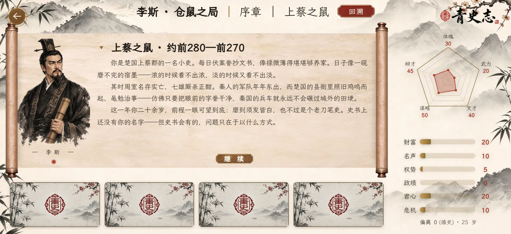
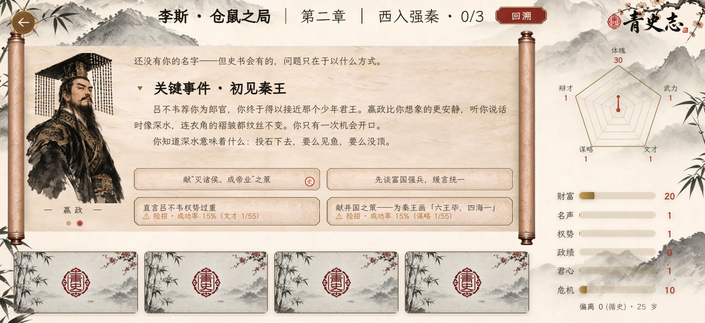
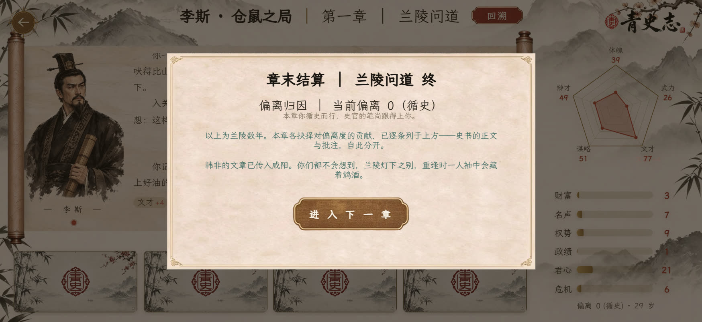
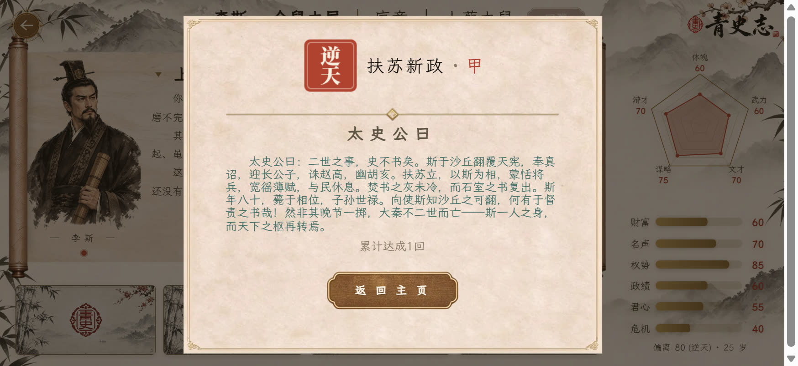
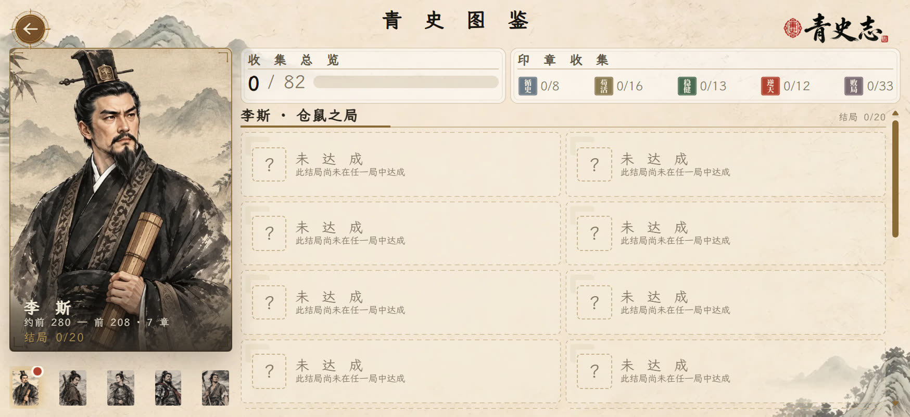

# 《青史志》官方攻略 #1：新手必读——你这局到底在玩什么

> **《青史志》官方攻略 · 第 1 期（机制入门）**
> 各位玩家好，这里是《青史志》开发组。很多新玩家进局第一反应是：这游戏到底在玩什么？这一期我们只讲**机制**，帮你把底层的账算明白。剧情路线和结局条件另开一期。文末和置顶评论有一张「一页速查」，建议收藏。

---

## 一、一局是怎么打的

一局 = 若干章 → 每章若干回合 → 每回合打牌 + 处理事件 → 章末结算 → 落到一个结局。

- **回合**：每回合 3 张行动卡 + 顶部一条「关键事件卡」（限时 3 回合，倒计时归零强制进事件，躲不掉）。
- **事件**：进入事件页是几个选项，各有门槛与后果。**这是全局最关键的选择**，行动卡只是铺垫。
- **章末 / 结局**：章末看偏离归因与属性差值；最后一章走完按路线落结局，带印章、评分与十档评级。

---

## 二、属性：你其实在管四件事

十一种属性，每项 0–100，数值越高评语越好。**危机**是唯一「风险」条，满 100 就出事。

| 归类 | 属性 | 管什么 |
|---|---|---|
| 生存 | 体魄、武力 | 命还在不在；武力是某些事的通行证 |
| 资源 | 财富、文才、谋略、辩才 | 财富能「兑换」；后三者是智力型门槛来源 |
| 影响力 | 名声、权势、政绩、君心 | 名望 / 位置 / 功业 / 上位者态度 |
| 风险 | 危机 | 满 100 出事 |

李斯初值示例（每条属性的四档评语见速查卡）：体魄 30 · 武力 20 · 文才 40 · 谋略 50 · 辩才 45 · 财富 20 · 名声 10 · 权势 5 · 政绩 0 · 君心 20 · 危机 10。别的剧本初值不同（项羽武力起点更高）。

---

## 三、偏离度：这局真正的分数

偏离度是你「改写历史」的累计幅度，四档：**循史**（≤20）复刻历史 · **微澜**（≤45）小挣扎 · **改流**（≤70）走向变 · **逆天**（≤100）全新历史。

- 它不是惩罚，是刻度：**终局「影响」分 = 偏离度×0.6 + 功业×0.4**，想刷高分它是主杠杆。
- 它也是结局准入门槛：走太偏或太保守，某些结局进不去。

---

## 四、五类行动卡：牌面只是「怎么花」

- **进取**：换影响力/资源，常带偏离度、易推高危机
- **兑换**：用财富换东西，风险小
- **守成**：补短板、稳属性
- **保身**：压危机、养体魄，是保险牌
- **抉择**：打出去进独立抉择，每两轮强制占牌位，整局一张只发一次

另有「求医问药」（染病时发，占牌位，财富 ≤ 0 不能求医）。

规则：硬门槛不达牌根本不出现（财富类默认硬门槛）；软门槛不足带 ⚠ 可冒险；同一张牌可反复打、收益不打折。

---

## 五、险招：什么时候该赌

⚠ 徽章 = 条件不够、想走就得赌。**一句话：差 3 点以内可赌，9 点以上别赌。**「史实」类选项成算升一档（更稳）。赌输很硬：该选项当场烧毁且事件直接终结，不能重选。

（成算具体对照见速查卡）

---

## 六、回溯：后悔药，药钱按次扣

回到本章开头重来；保留成就词条与偏离度（取大），重置本章旗标；每回溯一次总分 ×0.98。剧情无限 / 普通每章 1 次 / 硬核 0 次；终局与死亡后不可用。

---

## 七、危机与死亡

危机满 100：致命难度（普通/硬核）直接死；非致命（剧情）钳到 95。**几乎所有正数收益都在推高危机**——这是核心张力。危机 70–89 时本章会插一次「构陷际遇」。

---

## 八、章末结算怎么读

四块：① 偏离归因（谁推高了偏离度）② 属性差值（条目之和 = 真实净变化）③ 偏离档名 ④ 下一章（看不到就是这局到头了）。

---

## 九、评分与三档难度

总分 =（功业×0.3 + 存续×0.3 + 史评×0.2 + 影响×0.2）× 难度系数 ×（逆天×1.15）× 回溯惩罚。十档评级（甲上 95 → 丁兜底）见速查卡。

- **剧情**：全可见、无限回溯、不会死，适合先看懂 / 收集
- **普通**：标准，每章 1 次后悔药
- **硬核**：无回溯、危机 ×1.2、卡面数字抹成「耗财/费力」、评分 ×1.25（含金量更高）

---

## 十、解锁下一部与收集

上一部达成**乙级及以上 + 解锁 3 个不同结局**，解锁下一部（所以第一部多打两三条路线即可）。成就与词条**跨局累计**、中途退出也算数。全五部共 **65 成就 / 153 词条 / 40 结局**。

---

## 十一、存档小贴士

自动档（点「返回」时写，每部最多 6 条）、暂存（关页兜底）、云存档（自动同步，有频率限制）。云端覆盖本地会先留一份本地备份。

---

> ——《青史志》开发组
>
> 有用就点关注，下期聊「藏在界面背后的那笔暗账」。机制疑问评论区见，按引擎口径回。
>
> *本系列只讲机制，不含剧情路线与结局达成条件；数据以游戏内实际为准。*
