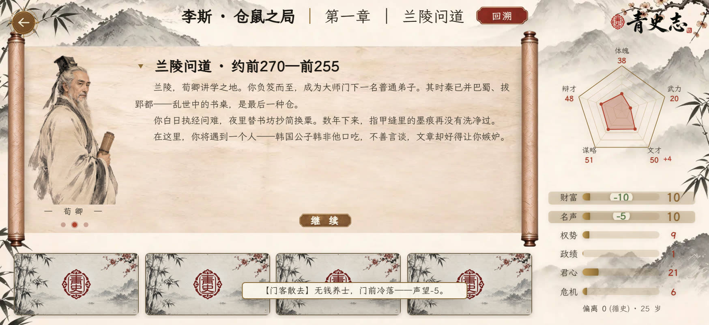

# 《青史志》官方攻略 · 进阶篇（1/4）：章首暗账——那些自动结算的小字

> **《青史志》官方攻略 · 进阶篇 第 1 篇 / 共 4 篇**
> *建议先读完入门篇 6 篇。*
>
> 入门篇讲了「看得见的规则」。进阶篇，开发组带你掀开帘子，看那些**界面上看不见、却一直在动你属性的账**。这一篇先讲「章首那几行小字」。

## 章首小字不是叙事，是自动结算

每次进新章飘出的提示（春秋渐高 / 树大招风 / 失宠于上……）不是文案，是引擎在背后动你属性。重点：

| 提示 | 触发 | 后果 |
|---|---|---|
| 树大招风 | 权势 ≥ 80 | 危机 +5 × 难度系数 |
| 失宠于上 | 君心 ≤ 15 | 危机 +10 × 难度系数 |
| 门客散去 | 财富 ≤ 0 | 声望 −5 |
| 功高震主 | 声望≥80 且 君心<40 | 危机 +10（整局一次） |
| 宗室觊觎 | 财富 ≥ 上限 90% | 危机 +8（整局一次） |

- 危机类暗账都乘难度系数（剧情 ×0.6 / 普通 ×1 / 硬核 ×1.2）；一次性效果只触发一次。
- **推论**：权势冲 80+、家产逼近上限，是在给自己点火。

## 还有两处骰子（顺带提一句）

- **际遇**：每回合 40% 概率触发，每章至多 2 次，是意料之外的事，常是机会也常是麻烦。
- **历史修正**：章末掷一次骰，按高/中/低三档决定是否触发一条「历史修正」——改写本章已经发生的事，通常伴随属性变化与偏离度。修正的骰点概率受难度系数影响（剧情 ×0.5 / 普通 ×1 / 硬核 ×1.3）。

> ——《青史志》开发组
>
> 下一篇聊「功业标记与史评：分数里最重的两块」。机制疑问评论区见。
>
> *本系列只讲机制，不含剧情路线与结局达成条件；数据以游戏内实际为准。*
